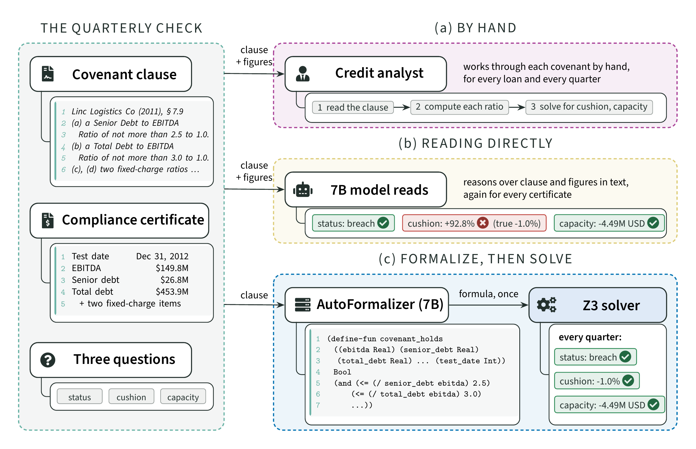

# FormaFin: Training Small Open Models to Verify LLM Financial Analyses with Symbolic Feedback

Financial analyses often apply a written rule to reported figures: a lender tests a borrower's quarterly figures
against the covenants of its loan agreement. These checks must be exact and auditable, and the data are confidential,
so they call for small open models run in-house. FormaFin trains such a model to **formalize** each rule once into an
SMT formula that captures its thresholds, date schedules and conditions. The Z3 solver then answers every question
exactly, checks any LLM's analysis against the formula, and proves properties of the formula itself. Training needs no
human labels: distillation from a teacher, then GRPO with a reward that Z3 derives from the limits each rule states,
then trust through proven agreement between two independently trained formalizers. Case study: loan covenant
monitoring on CovenantBench.




## Results

CovenantBench: 143 covenant clauses from borrowers never seen in training, 1,064 compliance certificates. Score: share
of the three questions (status, earnings cushion, debt capacity) answered correctly, averaged over clauses.

| System | Size | Score | Earnings cushion |
|---|---|---|---|
| Qwen2.5-Coder-7B, reads the clause directly | 7B | 64.8 | 33.7 |
| Qwen3.8-27B, reads directly | 27B | 88.8 | 84.8 |
| Qwen2.5-Coder-32B, reads directly | 32B | 85.8 | 75.6 |
| Llama-3.3-70B (4-bit), reads directly | 70B | 79.1 | 67.2 |
| FormaFin, SFT only (Qwen2.5-Coder-7B) | 7B | 85.8 | 78.3 |
| **FormaFin, Qwen2.5-Coder-7B (3 seeds)** | **7B** | **94.8 ± 1.0** | **93.5 ± 3.6** |
| **FormaFin, Llama-3.1-8B (3 seeds)** | **8B** | **96.8 ± 1.1** | **93.3 ± 3.7** |
| **FormaFin, Mistral-7B (3 seeds)** | **7B** | **92.6 ± 1.3** | **88.0 ± 1.1** |

- **Small beats large.** Every 7-8B FormaFin model scores above every reader up to 70B; the 7B model is 6.1 points above
  the best reader (Holm-corrected p = 0.004) and 15.7 above the 70B reader.
- **The recipe transfers.** Three families start far apart (25-65% reading directly, 35-86% after SFT) and end at
  92.6-96.8%; every family passes the best reader within 250 GRPO steps.
- **Same accuracy on breaches as on safe cases.** A correct formula answers every certificate correctly; readers lose
  up to 42 points exactly when the borrower is in breach.
- **Verifies LLM analyses.** Checked against FormaFin's formulas, 98-99.7% of the errors of open LLMs (and 95.6% of a
  proprietary model's) are caught, and the accepted answers are 99-99.9% correct.
- **Provable without labels.** 74% of the formulas are proven correct by Z3 for every possible certificate; where two
  independently trained formalizers provably agree (92% of clauses), they are right 98.4% of the time.
- **The reward must constrain every input.** Without the interface gate, or with tests at a single test date, the
  policy learns to exploit the gap; the final reward tests every limit in every date window, condition and several
  test dates.

## Repository layout

```text
.
├── src/
│   ├── paths.py           # every data, model and result location
│   ├── data_prep/         # clause extraction, splits, borrower-disjoint test set, RL clause pools
│   ├── formalization/     # SMT validation, prompts, Z3 decisions, reference extractor
│   ├── training/          # SFT data generation, SFT, GRPO with the solver-checked rewards
│   ├── headroom/          # benchmark construction, evaluation, scoring, verification, tables and figures
│   ├── common/            # LoRA loading, batched generation
│   └── verifiqa/          # LLM clients (Claude and Codex command-line tools)
├── data/
│   ├── splits/            # train / validation / test and the borrower-disjoint test set
│   ├── sft/               # the 789 SFT pairs and their generation audit
│   ├── rl/                # unlabeled RL clause pools (rl_v3: the final reward's pool)
│   ├── headroom/          # reference readings, specs, cases, reference validation
│   ├── raw/               # source agreements (not included, see "Data")
│   └── processed/         # extracted clause records (not included, rebuilt by stage 01)
├── models/                # LoRA adapters (not included, see MODELS.md)
├── notebooks/             # every table and figure
├── docs/                  # data and benchmark construction, pre-registration, data audit
├── scripts/               # env.sh, the pipeline stages and the experiments
└── tests/                 # unit tests
```

## Reproduce

```bash
source scripts/env.sh            # Python environment, src/ on PYTHONPATH, repository root
python -m pytest                 # unit tests

# pipeline
scripts/01_build_data.sh         # CPU: clauses, splits, borrower-disjoint test set, RL pool
scripts/02_train_sft.sh          # teacher pairs, then LoRA SFT (GPU)
scripts/03_build_benchmark.sh    # two-reader references, cases, reference validation
scripts/04_train_rl.sh           # GRPO with the first, single-date reward (exec_sig), three seeds (GPU)
scripts/05_evaluate.sh           # readers and formalizers, sensitivity reruns, formal verification, scores
scripts/09_schedule_reward.sh    # GRPO with the final reward (exec_sched): the final FormaFin model, three seeds (GPU)
scripts/06_paper.sh              # tables, figures, notebook (CPU)

# further experiments
scripts/06_binary_ablation.sh    # pass/fail reward ablation
scripts/07_llama_baseline.sh     # Llama-3.1-8B: reader, prompted, SFT, GRPO (first reward)
scripts/08_mistral_baseline.sh   # Mistral-7B: reader, prompted, SFT, GRPO (final reward)
scripts/10_llama_sched.sh        # Llama-3.1-8B GRPO with the final reward
scripts/12_llama70b_reader.sh    # Llama-3.3-70B reader in 4-bit NF4
scripts/13_checkpoint_eval.sh    # benchmark score of the GRPO checkpoints at steps 250 / 500 / 750
scripts/11_deepseek_coder.sh     # DeepSeek-Coder-6.7B (set up only, not evaluated)
```

Every stage can be resumed. `queue_*.sh` and `run_after.sh` chain GPU runs on a single machine. Python 3.12 (pinned
versions in `requirements.lock.txt`); one 96 GB GPU (each GRPO run takes about 1.5 hours). The teacher and reference
reader are called through the `claude` command-line tool. The TikZ figures are compiled when `pdflatex` is installed
(TeX Live `latex-extra`, `pictures`, `fonts-recommended`; the method figure also needs `fontawesome5`); otherwise
stage 06 writes only the `.tex` sources.

## Data

The clauses come from the loan-agreement text data of Ganglmair and Wardlaw (Zenodo record 20014336, CC BY 4.0;
"Complexity, Standardization, and the Design of Loan Agreements", SSRN 2952567). Place the archive in `data/raw/loan_data/`
before running stage 01. How the data was obtained and the benchmark built: [`docs/data_and_benchmark.md`](docs/data_and_benchmark.md).
