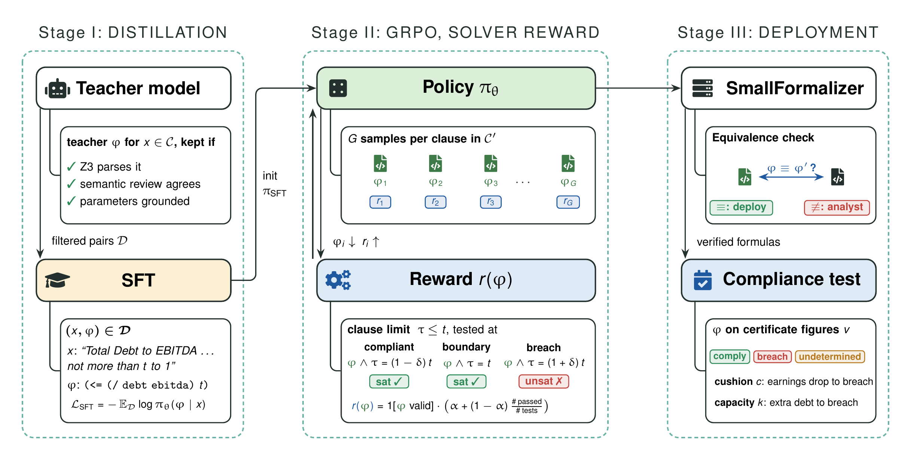

# FormaFin: Solver-Verified Loan Covenant Monitoring with a Small Language Model

Every quarter, for every loan, a lender asks three questions about each financial covenant: *is the borrower in
compliance, how far can its earnings fall, and how much more debt can it take?* FormaFin trains an open 7B model
(Qwen2.5-Coder-7B + LoRA) to translate each covenant once into an SMT formula over the compliance certificate's line
items; the Z3 solver then answers all three questions exactly, for any certificate, in-house.



## Results

Borrower-disjoint benchmark: 143 covenant clauses from borrowers never seen in training, 1,064 compliance certificates.

| System | Size | Score | Earnings cushion |
|---|---|---|---|
| Qwen2.5-Coder-7B, reads the clause directly | 7B | 64.8 | 33.7 |
| Qwen2.5-Coder-32B, reads directly | 32B | 85.8 | 75.6 |
| Qwen3.8-27B, reads directly | 27B | 88.8 | 84.8 |
| FormaFin, SFT only | 7B | 85.8 | 78.3 |
| **FormaFin, SFT + GRPO (3 seeds)** | **7B** | **95.0 ± 1.2** | **88.1 ± 3.2** |

- **GRPO adds +9.2 points over SFT** on every seed (Holm-corrected p < 0.001), with a reward computed by Z3 from the
  clause text alone: no labels, no judge model.
- **Same accuracy on breaches as on safe cases.** A correct formula answers every certificate correctly; models reading
  the clause directly lose up to 32 points exactly when the borrower is in breach.
- **Provable.** 71% of the formulas are proven correct by Z3 for every possible certificate; when two independently
  trained models produce formulas that Z3 proves equivalent (92% of clauses), they are right 97.9% of the time.

All tables and figures, with confidence intervals and tests: [`notebooks/headroom_paper.ipynb`](notebooks/headroom_paper.ipynb).

## Repository layout

```text
.
├── src/
│   ├── paths.py           # every data, model and result location
│   ├── data_prep/         # clause extraction, splits, borrower-disjoint test set, RL clause pools
│   ├── formalization/     # SMT validation, prompts, Z3 decisions, reference extractor
│   ├── training/          # SFT data generation, SFT, GRPO with the solver-checked reward
│   ├── headroom/          # benchmark construction, evaluation, scoring, verification, paper outputs
│   ├── common/            # LoRA loading, batched generation
│   └── verifiqa/          # LLM clients (Claude and Codex command-line tools)
├── data/
│   ├── splits/            # train / validation / test and the borrower-disjoint test set
│   ├── sft/               # the 789 SFT pairs and their generation audit
│   ├── rl/                # unlabeled RL clause pools
│   ├── headroom/          # reference readings, specs, cases, reference validation
│   ├── raw/               # source agreements (not included, see "Data")
│   └── processed/         # extracted clause records (not included, rebuilt by stage 01)
├── models/                # LoRA adapters (not included, see MODELS.md)
├── notebooks/             # headroom_paper.ipynb: every table and figure
├── docs/                  # data and benchmark construction, pre-registration, data audit
├── scripts/               # env.sh and the pipeline stages 01-06
└── tests/                 # unit tests
```

## Reproduce

```bash
source scripts/env.sh            # Python environment, src/ on PYTHONPATH, repository root
python -m pytest                 # unit tests
scripts/01_build_data.sh         # CPU: clauses, splits, borrower-disjoint test set, RL pool
scripts/02_train_sft.sh          # teacher pairs, then LoRA SFT (GPU)
scripts/03_build_benchmark.sh    # two-reader references, cases, reference validation
scripts/04_train_rl.sh           # GRPO, three seeds (GPU)
scripts/05_evaluate.sh           # both evaluation arms, sensitivity reruns, formal verification, scores
scripts/06_paper.sh              # tables, figures, notebook (CPU)
```

Every stage can be resumed. Python 3.12 (pinned versions in `requirements.lock.txt`); one 96 GB GPU. The teacher and
reference reader are called through the `claude` command-line tool. The TikZ figures are compiled when `pdflatex` is
installed (TeX Live `latex-extra`, `pictures`, `fonts-recommended`; the method figure also needs `fontawesome5`);
otherwise stage 06 writes only the `.tex` sources.

## Data

The clauses come from the loan-agreement text data of Ganglmair and Wardlaw (Zenodo record 20014336, CC BY 4.0;
"Complexity, Standardization, and the Design of Loan Agreements", SSRN 2952567). Place the archive in `data/raw/loan_data/`
before running stage 01. How the data was obtained and the benchmark built: [`docs/data_and_benchmark.md`](docs/data_and_benchmark.md).
